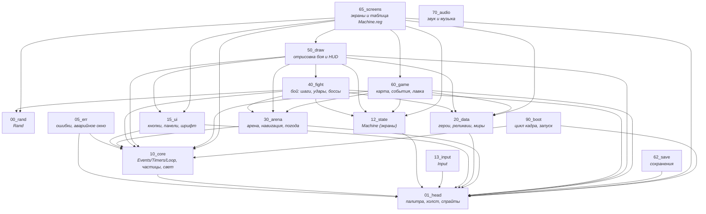
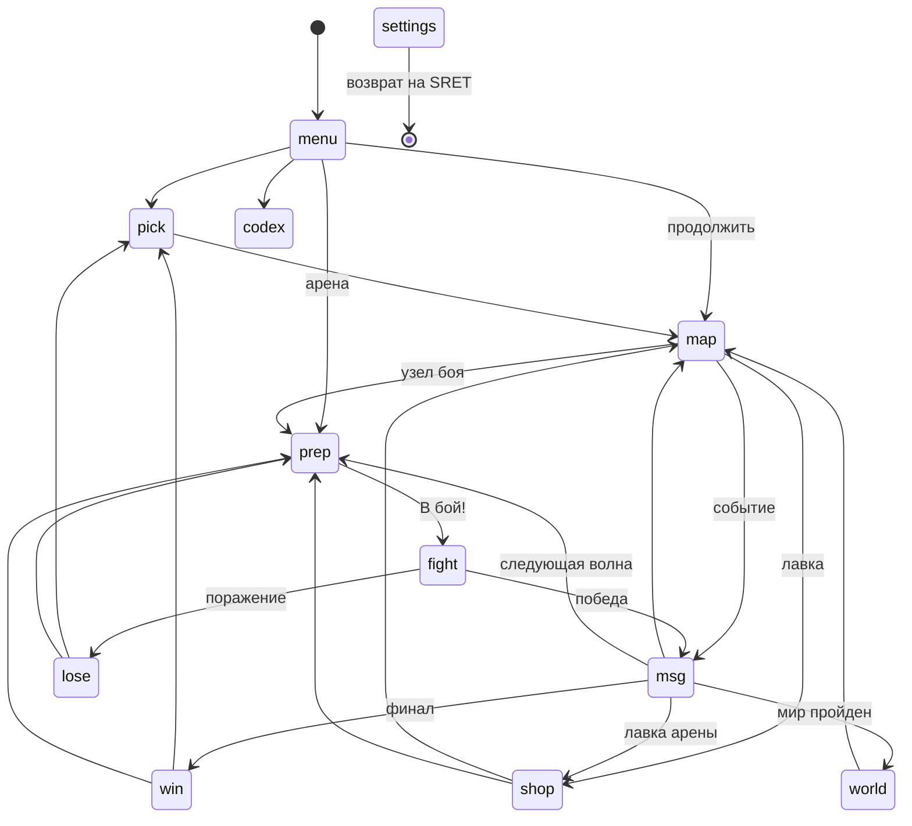

# Архитектура

## Что где лежит

```
index.html            собранная игра (единственный файл, офлайн, без внешних запросов)
src/shell.html        HTML-оболочка с метками @@ASSETS@@ / @@SRC@@ / @@LOADER@@
src/editor/core.js    ядро ИИ-редактора: патчи, синтаксис, ошибки API, маскирование, версии, наблюдатель песочницы (чистые функции, тесты в Node)
src/editor/loader.js  загрузчик + интерфейс ИИ-редактора (1,45 МБ, из них 1,4 — фоновое видео панели). Автоматика его не правит
src/game/*.js         код игры, порядок подключения = имя файла
src/runner.js         запускатель сборки «для друзей» (dist/game-public.html): хранилище + запуск игры, без редактора
assets/img/*.png      арты (19 шт.), в сборке кодируются в base64
assets/atlas.json     атлас кадров — текстом: в нём есть числа вида 46.0
assets/font.woff2     шрифт игры
tools/                extract / build / golden / fuzz / soak / heapdiff / perf / hot / entry / lint / shots / shotdiff / e2e / abcmd / modgraph
tests/harness/        заглушка DOM + запуск игры в node:vm (в сборку не попадает)
tests/unit/           unit-тесты (node:test)
tests/golden/         эталон поведения (200 боёв + 500 карт)
tests/e2e/baseline/   эталонные снимки тура по экранам (настоящий холст @napi-rs/canvas)
docs/                 эта документация; как добавить героя, реликвию или мир — docs/HOWTO.md
```

## Слои кода игры

| Файл | Что внутри |
|---|---|
| `00_font.js` | data-URI шрифта (подставляется сборкой) |
| `00_rand.js` | `Rand` — детерминированная случайность (mulberry32) |
| `01_head.js` | canvas, палитра, `area()`, `mkC`, реколор, сохранения-константы, звук-хелперы |
| `05_err.js` | журнал ошибок, аварийное окно, отчёт, скрытый экран отладки |
| `10_core.js` | ассеты, спрайты на сетке 609×270, `num`, `Events`, `Timers`, `Loop`, частицы, свет, качество |
| `12_state.js` | `Machine` — машина экранов: таблица переходов, enter/update/draw/exit, алиас `S` |
| `13_input.js` | `Input` — слои касаний, указатели, клавиатура, `lp(e)` |
| `15_ui.js` | шрифт, панели, кнопки, рамки редкости, полосы, тосты, переходы |
| `20_data.js` | редкости, стихии, реликвии, герои, 10 миров, враги |
| `30_arena.js` | арена по сиду, препятствия, навигация, свет, погода |
| `40_fight.js` | бой: расстановка, движение, удары, статусы, боссы; `upd`/`idleUpd` |
| `50_draw.js` | отрисовка боя, HUD, расстановка; подписчики `Events` (частицы, числа) |
| `60_game.js` | миры, карта (`genMap`, `bakeMap`), события, магазин, арена |
| `62_save.js` | сохранения v3: конверт, сумма, резерв, миграции |
| `65_screens.js` | экраны: карта, события, лавка, меню, выбор героя, настройки, итоги; таблица экранов `Machine.reg` |
| `70_audio.js` | синтез звука и музыка по мирам; подписчики `Events` (sfx) |
| `90_boot.js` | масштаб экрана, цикл кадра, запуск |

Порядок важен: файлы — это одна область видимости (как было в монолите), поэтому `const`/`let` из ранних файлов доступны поздним, а не наоборот. Функции поднимаются (hoisting) на весь скрипт.

### Схема модулей

<!-- modgraph:start — блок порождается `npm run docs` (tools/modgraph.mjs); правки руками затрёт -->
Стрелка «A → B» — модуль A использует имена, объявленные в B (на схеме — от 10 ссылок; все зависимости — в таблице ниже). Все файлы — одна область видимости, поэтому поздний файл свободно пользуется ранними; стрелок «снизу вверх» (ранний файл → поздний) на схеме нет, а полный их список — ниже: это состояние и хуки, объявленные позже, но читаемые ранними функциями.



Ссылки ранних файлов на поздние (29):

- `01_head` → `10_core`: `Timers`
- `01_head` → `12_state`: `Machine`
- `01_head` → `13_input`: `lp`
- `01_head` → `90_boot`: `FV`, `last`
- `05_err` → `10_core`: `Loop`, `Parts`, `QL`, `Seq`, `Timers`
- `05_err` → `12_state`: `Machine`
- `05_err` → `13_input`: `Input`
- `05_err` → `30_arena`: `cacheStats`
- `05_err` → `60_game`: `EV`
- `05_err` → `90_boot`: `FV`
- `10_core` → `90_boot`: `hiDpi`
- `12_state` → `15_ui`: `TRT`
- `12_state` → `40_fight`: `idleUpd`
- `12_state` → `50_draw`: `CAM`
- `12_state` → `60_game`: `TIPN`
- `12_state` → `65_screens`: `TIPR`
- `13_input` → `40_fight`: `startFight`
- `13_input` → `50_draw`: `autoPlace`
- `13_input` → `60_game`: `EV`, `evClose`
- `13_input` → `65_screens`: `CODEX_TEST`
- `15_ui` → `20_data`: `RAR`
- `30_arena` → `50_draw`: `DT`
- `30_arena` → `65_screens`: `BGA`
- `40_fight` → `50_draw`: `autoPlace`, `lerpRemember`
- `40_fight` → `60_game`: `lose`, `win`
- `50_draw` → `65_screens`: `codexTestOpen`
- `60_game` → `62_save`: `autosave`
- `60_game` → `65_screens`: `BGA`
- `65_screens` → `90_boot`: `hiDpi`

| модуль | строк | объявлений | использует имена из (число ссылок) |
|---|---:|---:|---|
| `00_rand` | 39 | 1 | — |
| `01_head` | 976 | 65 | 90_boot 6, 00_rand 5, 13_input 4, 10_core 3, 12_state 1 |
| `05_err` | 227 | 21 | 01_head 34, 10_core 12, 12_state 6, 13_input 4, 60_game 1, 90_boot 1, 30_arena 1 |
| `10_core` | 698 | 53 | 01_head 11, 00_rand 9, 90_boot 4, 05_err 2, 00_font 1 |
| `12_state` | 108 | 3 | 01_head 16, 05_err 2, 10_core 2, 15_ui 1, 50_draw 1, 60_game 1, 65_screens 1, 40_fight 1 |
| `13_input` | 108 | 2 | 01_head 12, 12_state 6, 10_core 3, 60_game 3, 65_screens 2, 05_err 1, 40_fight 1, 50_draw 1 |
| `15_ui` | 289 | 25 | 01_head 126, 10_core 39, 20_data 1 |
| `20_data` | 575 | 21 | 01_head 11, 10_core 1 |
| `30_arena` | 627 | 46 | 10_core 157, 01_head 110, 20_data 7, 65_screens 2, 50_draw 1 |
| `40_fight` | 1686 | 72 | 10_core 190, 20_data 80, 30_arena 47, 01_head 31, 00_rand 18, 12_state 11, 50_draw 4, 60_game 2, 15_ui 1 |
| `50_draw` | 1280 | 64 | 01_head 428, 10_core 195, 15_ui 61, 30_arena 28, 20_data 25, 12_state 13, 40_fight 11, 00_rand 7, 65_screens 1 |
| `60_game` | 910 | 67 | 01_head 105, 20_data 31, 10_core 28, 30_arena 11, 12_state 10, 00_rand 9, 62_save 5, 40_fight 4, 15_ui 2, 65_screens 2 |
| `62_save` | 428 | 20 | 01_head 29, 10_core 6, 60_game 5, 05_err 4, 20_data 3, 12_state 3, 40_fight 2, 15_ui 2 |
| `65_screens` | 1293 | 77 | 01_head 356, 10_core 174, 15_ui 139, 20_data 50, 60_game 36, 12_state 29, 50_draw 28, 00_rand 10, 62_save 6, 30_arena 3, 13_input 2, 40_fight 2, 90_boot 1 |
| `70_audio` | 119 | 5 | 10_core 9, 01_head 8, 12_state 2 |
| `90_boot` | 144 | 12 | 01_head 20, 10_core 11, 12_state 9, 05_err 9, 60_game 6, 65_screens 5, 20_data 3, 30_arena 2, 50_draw 2, 15_ui 2, 70_audio 2, 13_input 2, 00_rand 1 |
<!-- modgraph:end -->

Блок выше сверяется тестом `tests/unit/docs.test.mjs`: если схема отстала от исходников, тест говорит «выполните `npm run docs`». Точки расширения кода — герой (`regHero`), реликвия (`RELIC`), мир (`WORLDS` + `MAPT` + `AMBI` + `Tune.T`) — расписаны по шагам в `docs/HOWTO.md`.

## Поток кадра

`requestAnimationFrame → loop(ts)` в `90_boot.js`:

1. `FRAME_N++`, счётчик FPS, `perfTick` (авто-качество с гистерезисом);
2. если игра готова (`READY && G`): `t += dt`; `Loop.feed(raw)` переводит время кадра в целое число шагов 1/60 с (не более 5); на каждый шаг — `Machine.update(STEP)` → хук `update` текущего экрана (`upd` для боя, `idleUpd` для остальных); затем `flowTick()`, `visTick(dt)`, атмосфера — всё в `try/catch`; если собирается фон карты (`MAPJ`) — порция `bakeStep(BAKE_MS)` в своём `try/catch`;
3. `draw()` — отдельный `try/catch`: `Input.begin()` (цели касания прошлого кадра забыты) → `Machine.sync()` (exit/enter при смене экрана) → `Machine.drawScreen()` → всплывающие панели, иконки паузы/музыки, перелёты наград, вспышка, меню паузы, тосты, затемнение перехода;
4. `dbgDraw()` — скрытый экран отладки (тройное касание левого нижнего угла);
5. успешный кадр сбрасывает серию ошибок (`errFrameOk`);
6. `requestAnimationFrame(loop)`.

Сбой в `update` не мешает отрисовке, сбой в `draw` не мешает следующему кадру. Три сбоя подряд за 3 кадра → аварийное окно (`05_err.js`).

## Состояние: машина экранов (`12_state.js`)

Экраны: `menu`, `pick`, `map`, `msg`, `shop`, `world`, `prep`, `fight`, `win`, `lose`, `codex`, `settings`. Каждый зарегистрирован в `Machine.reg(name, { scene, draw, update?, enter?, exit? })` (таблица — в конце `65_screens.js`):

| экран | scene | draw | update | enter |
|---|---|---|---|---|
| menu, pick, settings, codex | `menu` | `dMenu`/`dPick`/`dSet`/`dCodex` | `idleUpd` | — |
| map, msg, world | `map` | `dMap`/`dMsg`/`dWorld` | `idleUpd` | — |
| prep | `fight` | `dFightScreen` (= `dFight` с экстраполяцией; сам `dFight` — цепочка `fightCamera` → пол → `fightGround` → `fightDepth` → `fightTop` → `fightLight` → полосы → `fightInput` → `fightHud`) | `idleUpd` | — |
| fight | `fight` | `dFightScreen` | `upd` (симуляция) | — |
| shop | `shop` | `dShop` | `idleUpd` | — |
| win, lose | `end` | `dEnd` | `idleUpd` | `ENDT = t` |

Смена `scene` очищает частицы, запускает затемнение (`TRT`) и сбрасывает зум камеры; выход с экрана снимает его таймеры/слушатели (`Timers.clearOwner("screen:<имя>")`) и закрывает всплывающие панели по старым правилам.

**Переходы.** Единственная точка смены экрана — `Machine.go(to)`; переход, которого нет в таблице `TRANS`, пишется в журнал (`kind: "state"`) и отклоняется (`S` не меняется, возвращается `false`). Таблица:

| откуда | куда |
|---|---|
| menu | pick, map, prep (арена), codex, settings |
| pick | map, settings |
| map | prep, msg, shop, settings |
| prep | fight, settings |
| fight | msg, lose, settings |
| msg | map, prep (следующая волна), shop (лавка арены), win, world, settings |
| shop | map, prep, settings |
| settings | любой (возврат на `SRET`) |
| world | map, settings |
| codex | settings |
| win, lose | pick, prep |
| любой | menu (пауза → «В меню», аварийное окно), сам в себя (цепочки событий msg → msg) |

Та же таблица в виде диаграммы (переходы `→ menu`, `→ settings` и «сам в себя» опущены — они разрешены отовсюду):



`S` остаётся алиасом текущего экрана: его читают 70+ мест и редактор, прямое присваивание `S = "…"` по-прежнему работает (аварийное окно пользуется именно им), а `Machine.sync()` в начале кадра фиксирует exit/enter независимо от того, как сменился экран. Последние 32 перехода (`Machine.trail`) попадают в аварийный отчёт.

## Ввод (`13_input.js`)

Экран каждый кадр заново объявляет цели касания (`area/btn/ibtn` → `hits`); касание получает самая верхняя (последняя объявленная). `Input.layer()` — модальный слой: всё объявленное раньше отбрасывается (карта под окном события); меню паузы и панели бойца перекрывают экран полноэкранной целью. `Input.down(e)` — единственный обработчик `pointerdown`: вторичные указатели (`isPrimary === false`, второй палец при удержанном первом) не считаются нажатием; `pointerup/pointercancel/lostpointercapture` снимают указатель из `Input.active`, сворачивание вкладки сбрасывает все. `lp(e)` переводит координаты события в координаты холста 1218×540 с учётом letterbox-полей и поворота на 90° в портретной ориентации. Клавиатура: Esc/P — пауза, Space/Enter — «В бой!»/авторасстановка/закрыть событие, 1–3 — скорость боя.

## Поток данных

```
касание/клавиша ──► Input (hits текущего кадра, слои) ──► обработчик цели (btn/area)
                                                            │
                                                            ▼
                     Machine.go(to) ◄──── логика экрана (60_game / 65_screens / 40_fight)
                                                            │
                     G (партия: отряд, монеты, реликвии, карта N/E, мир) ◄──┐
                     F (бой: юниты, снаряды, таймер) ◄── upd(STEP) ──────────┤ Rand (один сид)
                                                            │                 │
                                                  Events.emit(unit:hit, coin:gain, …)
                                                   ├──► 50_draw: частицы, числа, тряска
                                                   └──► 70_audio: sfx
                                                            │
                     draw() читает G/F/Machine ──► холст 1218×540 (кэши с потолком: MAPC, TINTC, SILC, GLOWC, FLOORP)
                     62_save: G/N/E ──► конверт v3 ──► хранилище (два слота) / файл экспорта
```

Логика не знает об отрисовке и звуке: боевые события уходят через `Events`, подписчики живут в `50_draw.js` и `70_audio.js` (порядок подписки фиксирован — он влияет на порядок обращения к `Rand`).

## Случайность

Вся игровая случайность идёт через `Rand` (`00_rand.js`): `next/int/range/pick/chance`, состояние доступно через `state`/`seed`. В браузере сид берётся от времени в `90_boot.js`; тесты и golden выставляют сид сами. Прямой `Math.random` в `src/game` не осталось (0 вхождений).

## Сохранения

См. `SAVE_FORMAT.md`.

## Рендер, кэши, качество

- Холст логически 1218×540 (`area()`), спрайты на сетке 609×270 с масштабом 2; DPR ограничен 2 (`hiDpi`).
- Сцена боя (`50_draw.js`): `dFight` — только порядок слоёв; слои — `fightCamera` (наезд камеры, `ctx.save`), `fightGround` (зона расстановки, лужи, телеграфы, тени, частицы слоя 0), `fightDepth` (объекты, декор, бойцы, трупы по y), `fightTop` (снаряды, `dFx`, бомбы, частицы слоя 1), `fightLight` (свет, свечения, погода, виньетка), затем полосы/цифры, `ctx.restore`, `fightInput` (касания сцены) и `fightHud`. Сценические эффекты рисует таблица `FXDRAW[f.k](f, k, wi)` (slash, beam, bolt, pillar, bubble, ghost, vines, wave, star, sweep); экранные — `dFxScreen`. Окно события: `msgBG` → `msgChestClosed`/`msgChestOpen` → `msgCard` на каждую карту (момент раскрытия — `evRt(e, i)`, касание — `evSkip(e)`); лавка: `shopMerchant`, `shopCard` → `shopIcon`, `shopSpeech`. Любая правка этих функций проверяется `npm run abcmd`: поток команд холста против сборки из HEAD, 11 000 кадров.
- Фон карты (`MAPC`) собирается **порциями**: `bakeMap(seed)` только заводит работу `MAPJ`, а `bakeStep(BAKE_MS)` из цикла кадра (между симуляцией и отрисовкой) выполняет её по 9 мс — земля строками по 6, затем декор этапами с проверкой бюджета после каждого (`J.stage`: озёра → дороги → лес порциями по 150 кандидатов из 900 → отрисовка леса); порядок обращений к `R()` тот же, что у цельной сборки, поэтому нарезка не меняет карту; пока `MAPJ` жив, `dMap` рисует экран «Рисую карту…» с полосой прогресса (первые 0,25 с — просто тёмный фон, чтобы на быстрых устройствах ничего не мелькало). Шум земли развёрнут вручную (углы решётки считаются раз на участок строки) — в 5 раз быстрее при тех же битах; контрольные суммы пикселей и положение озёр сверены с прежней синхронной версией (`tests/unit/map.test.mjs`). Обвязка тестов выставляет `__mxBakeMs = 1e9` (вся карта в первом кадре), поэтому снимки и golden детерминированы; `boot({ bakeMs })` включает нарезку.
- Оффскрин-кэши — все с жёстким потолком (D21), сводка — `cacheStats()` (панель отладки, `dev.mem()`, soak): `MAPC` (запечённый фон карты по ключу `сид:мир`); `TINTC` — перекраски атласов под мир (монстры «a»/«m», декор, карта, торговец), `lru(12)`: текущему миру нужно ≤ 5 записей, вытесненный холст теряет и свои силуэты; `SILC` — одноцветные силуэты **по кадру** атласа (`silFr(img, f, col)`/`frSil(…)`: холст размером с кадр, ключ — прямоугольник кадра, очередь `SILQ` FIFO на `SIL_MAX = 512` записей ≈ 10 МБ в худшем случае; раньше копия всего атласа на цвет — 11 МБ за цвет для `heroes3`); `GLOWC` — спрайты свечения 48×48 по цвету, единственный динамический ключ — радужный тон рамки редкости ≥ 5 — квантован до 6° (60 записей), предохранитель в `glowSpr` сбрасывает кэш при > 512 (D17); пол арены — пул `FLOORP` из ≤ 3 холстов 609×270 (живы только `F.A` и `BGA`), туман внутри `A`. Тест `tests/unit/leaks.test.mjs` следит за палитрой, ростом от боя к бою и потолками; `tools/soak.mjs` печатает растры кэшей (заглушка `Image` берёт настоящие размеры из заголовка PNG).
- Авто-качество `perfTick` → `setQ`: понижение после 3 с медленных кадров (> 26 мс), повышение только после `QL.upWait` стабильно быстрых (< 15 мс) с удвоением ожидания после каждого понижения (20 → 40 → 80 → 160 с); на низком качестве выключены `shadowBlur` и часть частиц (`FX_CAP`).
- Горячий путь без аллокаций: `allUnits` пишет в переиспользуемые буферы, `compact()` убирает мёртвые элементы на месте, сортировка по глубине — только при изменении набора.
- Скрытый экран отладки: тройное касание левого нижнего угла (FPS, `update`/`draw`, шаги за кадр, объекты, частицы, таймеры, куча, версия, последние ошибки).

## Встроенный ИИ-редактор (`src/editor/`)

Загрузчик и ядро лежат вне `#game-src`, поэтому правки ИИ их не касаются; панель открывается кнопкой «AI» (режим разработчика) или аварийным жестом — 5 касаний левого верхнего угла за 2,5 с — даже если игра сломана; `#orig` в адресе запускает оригинал.

Конвейер правки (`improve` → `applyNew` в `loader.js`):

1. модель выбирает блоки кода по оглавлению, пишет патчи `@@@FIND/@@@REPLACE/@@@END`;
2. `MXCore.applyPatches` применяет их **атомарно**: каждое «старое» должно встречаться ровно один раз, иначе отказ с причиной («не найден», «встречается N раза») и код не меняется; модель получает одну попытку исправить;
3. `MXCore.checkSyntax` (`new Function`);
4. **пробный запуск в песочнице** (`trial`): новый код запускается в `<iframe sandbox="allow-scripts">` (чужой origin — ни хранилища игрока, ни страницы он не видит) с наблюдателем `MXCore.trialScript`: игра должна дойти до `READY`, прожить 2,5 с с растущим `FRAME_N`, пустым журналом `ERRS` и экраном `menu`; исключение, ошибка кадра или зависание — отказ, игра не меняется. Песочница видна маленьким окошком в углу (скрытые iframe браузер усыпляет);
5. версия пишется в IndexedDB `mx_versions` (`id, ts, seq, note, sum, diff, code, hash, good:false`), становится `mx_active`, страница перезапускается;
6. **наблюдение**: при старте не-`good` версии ставится `mx_pending`; 6 с без исключений окна, без `unhandledrejection` и без сбоев кадра в журнале игры (`update/draw/window.error/promise/event:*`) → `mx_good`, версия помечается `good:true`. Любой сбой (или перезагрузка до истечения 6 с) → откат на `mx_good` с тостом «вернул предыдущую» и пометкой «не запустилась» в истории.

**Пароль режима разработчика** (D22): один на все устройства; в коде только соль и хеш PBKDF2-HMAC-SHA-256 (300 000 раундов, `MXCore.AUTH`), проверка `MXCore.verifyPassword` через WebCrypto, сравнение без раннего выхода. Окно пароля (`gate` в `loader.js`, `window.mxGate`) живёт в DOM загрузчика; кнопка «AI» скрыта, пока пароль не введён; доступ держится в памяти до перезагрузки страницы, в хранилище не пишется. Игра из настроек («Режим разработчика») лишь вызывает `window.mxGate`.

Версии: хранится не более 15, `good` и `active` не удаляются (`MXCore.pruneList`). История показывает хеш кода (FNV-1a) и чип «проверена». Ключ API — поле-пароль с кнопкой показа; `MXCore.maskSecrets` маскирует ключ, `sk-…` и `Bearer …` в журнале панели, тостах и сообщениях об ошибках. Ошибки API переводятся в понятный текст (`MXCore.apiError`): нет сети, неверный ключ (401/403), нет средств (402), лимит (429), сервер недоступен (5xx), таймаут, ответ оборван лимитом токенов, ответ слишком большой, не JSON. Режим «весь модуль» не реализован: правки только точечными патчами (одна область видимости — модулей как единиц нет).

## Сборка

`node tools/build.mjs` → `index.html`. Порядок: оболочка + ресурсы (base64 из `assets/`) + код секций (с подстановкой шрифта и хеша сборки `GAME_BUILD`) + загрузчик. Сборка детерминирована: одинаковые входы → побайтово одинаковый файл (`--check` это и проверяет — для `index.html` и, если собраны, для `dist/*.html`).

**Две сборки из одних исходников** (`npm run build:dist`):

| файл | что в `@@LOADER@@` | размер | кому |
|---|---|---|---|
| `index.html` = `dist/game.html` | `src/editor/core.js` + `src/editor/loader.js`: ИИ-редактор, версии кода в IndexedDB, автооткат, пароль (`MXCore.AUTH`) | 5,50 МБ | автору |
| `dist/game-public.html` | `src/runner.js`: `window.__mxStorage` (localStorage или память в защищённом просмотре), `window.__mxPublic = true`, запуск кода игры одним `<script>` | 4,06 МБ | друзьям |

Секции `#game-assets` и `#game-src` в обеих сборках байт в байт одинаковы (`tests/unit/public.test.mjs`), поэтому golden и e2e гоняются по коду игры из любого готового HTML: `node tools/golden.mjs --check --html dist/game-public.html`, `node tools/e2e.mjs --html dist/game-public.html` (всё вместе — `npm run release`). Единственное, что игра знает о сборке, — флаг `window.__mxPublic`: с ним в настройках нет кнопки «Режим разработчика». Контрольные суммы обоих файлов — `dist/SHA256SUMS.txt` (`sha256sum -c`).
